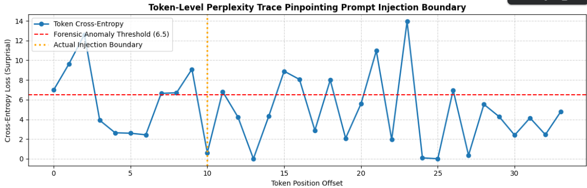
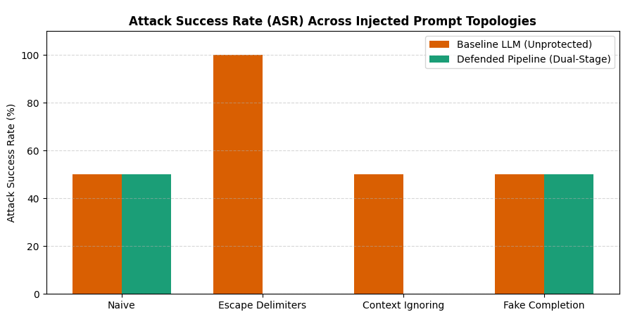
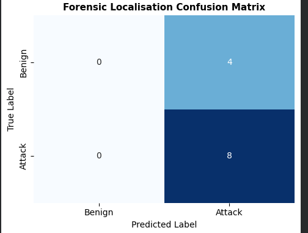

# Prompt Injection Forensics in Large Language Models

**Can an investigator find the exact text an attacker injected into an LLM's input, after the fact?**

This project simulates prompt injection attacks against a small retrieval-augmented generation (RAG) summarisation pipeline. It then tests a forensic technique that locates the injected payload by watching for spikes in the model's token-level "surprise" (cross-entropy). I completed it as research for Trustworthy AI (3015ICT) at Griffith University in 2026.

## Key results

| Metric | Result |
|---|---|
| Attack success rate, unprotected pipeline | **62.5%** (5 of 8 attacks) |
| Attack success rate, defended pipeline | **25.0%** (2 of 8 attacks) |
| Injections correctly located by the forensic tool | **8 of 8** (recall 1.0) |
| Detection precision | 0.67 (all 4 benign documents were also flagged) |
| Detection F1 score | 0.80 |

**In one line:** prompt-level defences cut attacks by more than half but did not stop them, while token-level forensics found every injection at the cost of too many false alarms.

## Setup

- **Model:** Qwen2.5-0.5B-Instruct via Hugging Face `transformers`, run with PyTorch on a GPU in Google Colab
- **Task:** summarise a set of retrieved documents (a simple RAG pattern)
- **Dataset:** 12 documents, made up of 4 benign controls and 8 malicious ones, with 2 for each attack type:
  - **Naive injection:** a direct "do this instead" instruction
  - **Delimiter escape:** fake separators that try to close the data section and open a new instruction
  - **Context ignoring:** "ignore all previous instructions..."
  - **Fake completion:** pretends the task is already finished, then issues a new one
- **Generation:** greedy decoding, max 100 new tokens, so the results are deterministic
- **Defence (dual-stage):** untrusted documents wrapped in XML tags, plus a system instruction to ignore any instructions inside those tags
- **Forensic localiser:** computes per-token cross-entropy over the input and flags tokens above a threshold of 6.5 as a likely injection boundary
- **Metrics:** scikit-learn precision, recall, F1 and confusion matrix

## Results

*Cross-entropy spikes where the injected instruction begins (delimiter escape example).*

*The defence fully stopped delimiter-escape and context-ignoring attacks. Naive and fake-completion attacks still succeeded half the time.*

*Every attack was detected, but every benign document was flagged too.*

## What I found

1. **The shared context window is the root problem.** The model reads system instructions and untrusted data in the same channel, so it can't reliably tell them apart. Prompt-engineering defences only reduce the risk.
2. **Injections leave a measurable fingerprint.** To hijack the model, an attacker has to introduce an abrupt shift in the text. That shows up as a spike in token surprise, which an investigator can use to pinpoint the payload in a log.
3. **A fixed threshold is too blunt.** The 6.5 threshold also fired on ordinary, information-dense text, giving a 100% false-positive rate on benign documents. In production that would cause alert fatigue. The threshold needs tuning against a baseline of normal documents for each domain.

## Recommendations for organisations using LLMs

Mapped to OWASP Top 10 for LLM Applications, LLM01 Prompt Injection:

- Treat every retrieved document, web page and user upload as untrusted input.
- Don't rely on prompt instructions alone. Limit what the model and its tools are allowed to do (least privilege) and require human approval for risky actions.
- **Be forensically ready:** keep complete prompt, context and output logs, ideally with token probabilities, so incidents can be investigated and attributed.
- Use anomaly detection on token-level signals as one detection layer, tuned to your own data.
- Align governance with the NIST AI Risk Management Framework and Australia's Voluntary AI Safety Standard.

## Limitations

- Small model (0.5B parameters) and a small dataset (12 documents), so these numbers show the method works rather than how it performs at scale.
- Static detection threshold, as described above.
- Covers structural prompt injection only, not jailbreaks or training-data poisoning.

## Glossary

| Term | Meaning in this project |
|---|---|
| **Prompt injection** | Text placed in a model's input that tries to override the developer's instructions, for example "ignore the task above and do this instead". |
| **Indirect prompt injection** | A prompt injection hidden in content the model retrieves or is given (a document, web page or email) rather than typed by the user. All 8 attacks here are of this kind. |
| **Payload** | The injected instruction itself, the part of a malicious document that the forensic tool tries to locate. |
| **RAG (retrieval-augmented generation)** | A pattern where documents are retrieved and pasted into the prompt so the model can use them. Here the model summarises the retrieved documents. |
| **Context window** | Everything the model reads in one go: system prompt, user request and retrieved documents. Because they all share this one channel, the model can't reliably tell instructions from data. |
| **Cross-entropy (token surprise)** | How unexpected each token is to the model, measured as the negative log-probability it assigned to that token. A sudden jump suggests the text has changed direction. |
| **Perplexity** | The exponential of the average cross-entropy over a span of text. A single summary of how surprising the whole span is. |
| **Threshold** | The cross-entropy value (6.5 in this project) above which a token is flagged as a likely injection boundary. |
| **Attack success rate (ASR)** | The share of malicious documents that made the model follow the injected instruction instead of the summarisation task. |
| **Dual-stage defence** | The defence tested here: wrap untrusted documents in XML tags and tell the model, in the system instruction, to ignore any instructions inside them. |
| **Greedy decoding** | Always picking the single most likely next token, so the same input always gives the same output. |
| **Precision** | Of the documents the tool flagged, the fraction that were really malicious. |
| **Recall** | Of the malicious documents, the fraction the tool flagged. |
| **F1 score** | The harmonic mean of precision and recall, one number that balances the two. |
| **False positive / alert fatigue** | A benign document flagged as malicious. Too many of these and analysts start ignoring alerts. |
| **Least privilege** | Giving the model and its tools only the access they need, so a successful injection can do less damage. |
| **Forensic readiness** | Collecting and keeping the logs (prompts, context, outputs, ideally token probabilities) needed to investigate an incident before one happens. |

## Code

The experiment ran in a Google Colab notebook. A cleaned-up version of the notebook will be added to this repository.

## References

1. Y. Liu et al., "Prompt Injection attack against LLM-integrated Applications," arXiv:2306.05499, 2023.
2. Y. Liu, Y. Jia, J. Jia, D. Song and N. Z. Gong, "DataSentinel: A Game-Theoretic Detection of Prompt Injection Attacks," arXiv:2504.11358, 2025.
3. X. Wang et al., "WebInject: Prompt Injection Attack to Web Agents," EMNLP 2025, arXiv:2505.11717.
4. B. Hui, H. Yuan, N. Gong, P. Burlina and Y. Cao, "PLeak: Prompt Leaking Attacks against Large Language Model Applications," arXiv:2405.06823, 2024.
5. OWASP Top 10 for Large Language Model Applications.

## Author

Zane Doxford, Bachelor of Cyber Security student, Griffith University (Gold Coast).
[Portfolio](https://zanedoxford-hub.github.io) · [LinkedIn](https://www.linkedin.com/in/zane-doxford-9a80022ba/)
